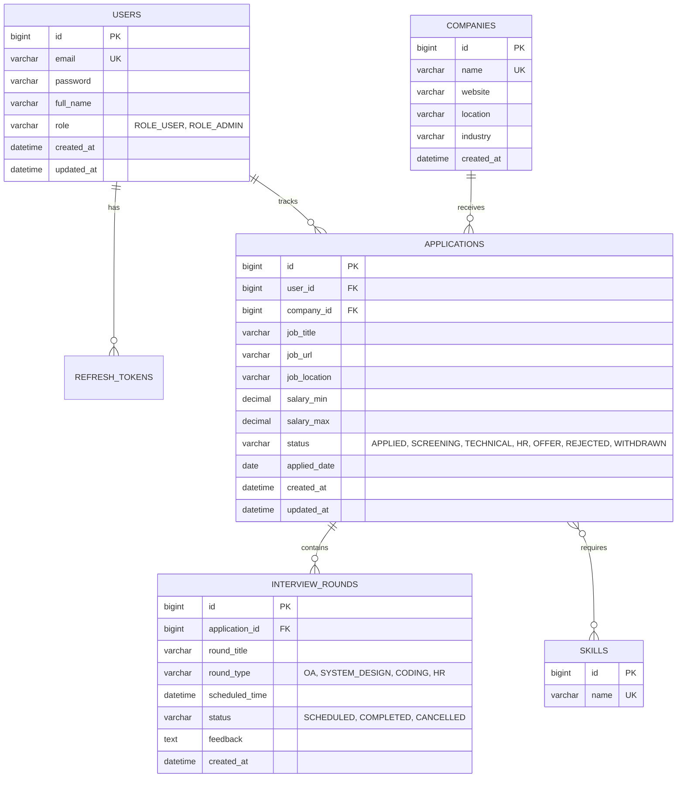

# CareerFlow: Job Application & Placement Management System
## Backend Architecture & Implementation Blueprint

---

### 1. Project Domain & Core Entities

**CareerFlow** is a comprehensive Career & Placement Management Platform designed to showcase enterprise-level Java backend engineering competencies (REST, Spring Security, JWT, JPA relationships, pagination, sorting, search, transactions, and unit testing).



---

### 2. Layered Architecture & Package Design

```
com.careerflow.backend/
├── config/              # Swagger/OpenAPI, CORS, WebMvc, SecurityConfig, AuditorAware
├── controller/          # REST Controllers (@RestController, versioned /api/v1)
├── dto/                 # Request/Response records & classes (decoupling entities from API)
│   ├── auth/            # LoginRequest, RegisterRequest, AuthResponse, RefreshTokenRequest
│   ├── application/     # ApplicationRequest, ApplicationResponse, StatusUpdateRequest
│   ├── company/         # CompanyRequest, CompanyResponse
│   ├── interview/       # InterviewRoundRequest, InterviewRoundResponse
│   └── common/          # ApiResponse<T>, PageResponse<T>, ErrorResponse
├── entity/              # JPA Entities with Auditing, validation, relationships
├── exception/           # Custom exceptions + @RestControllerAdvice (GlobalExceptionHandler)
├── mapper/              # Entity <-> DTO mappers (clean conversions)
├── repository/          # Spring Data JPA Repositories (JpaSpecificationExecutor, custom JPQL)
├── security/            # JwtUtils, JwtAuthenticationFilter, CustomUserDetailsService
├── service/             # Service interfaces & @Service implementations (@Transactional)
└── validation/          # Custom validators (e.g., ValidEnum, DateRangeValidator)
```

---

### 3. Step-by-Step Implementation Roadmap

#### Phase 1: Foundation & Project Setup
1. **Initialize Spring Boot 3.3.x / Java 21 LTS project**:
   - Dependencies: `spring-boot-starter-web`, `spring-boot-starter-data-jpa`, `spring-boot-starter-security`, `spring-boot-starter-validation`, `mysql-connector-j`, `jjwt-api` (0.12.x), `springdoc-openapi-starter-webmvc-ui`, `lombok` (optional or clean Java records).
2. **Database configuration**:
   - Configure MySQL connection pool (`HikariCP`), dialect, schema generation, and logging in `application.yml` and `application-dev.yml`.
3. **Common API Envelope & Global Exception Handling**:
   - `ApiResponse<T>`, `ErrorResponse`, `ResourceNotFoundException`, `BadRequestException`, `DuplicateResourceException`, `UnauthorizedException`.
   - `@RestControllerAdvice` mapping validation errors (`MethodArgumentNotValidException`), JPA constraint violations, and bad credentials.

#### Phase 2: Security & Authentication (JWT + Spring Security 6)
1. **User & Role Entity**:
   - `User`, `Role` (ENUM: `ROLE_USER`, `ROLE_ADMIN`), `RefreshToken`.
2. **Spring Security 6 Configuration**:
   - Stateless session management (`SessionCreationPolicy.STATELESS`).
   - `SecurityFilterChain` with `JwtAuthenticationFilter` before `UsernamePasswordAuthenticationFilter`.
   - Custom `AuthenticationEntryPoint` & `AccessDeniedHandler` returning clean JSON error responses.
3. **JWT Engine**:
   - Access token (short-lived) + Refresh token (stored & rotatable).
   - BCrypt password encoder (`BCryptPasswordEncoder`).
4. **Auth Endpoints**:
   - `POST /api/v1/auth/register`
   - `POST /api/v1/auth/login`
   - `POST /api/v1/auth/refresh-token`
   - `GET /api/v1/auth/me`

#### Phase 3: Core Business Domain (Company, Application, Interview)
1. **Company Management**:
   - CRUD with pagination, search by name/industry, unique constraints.
2. **Job Application Management**:
   - Create, Read, Update, Delete with strict User ownership validation.
   - Dynamic filtering using Spring Data JPA Specifications (filter by status, company, date range, salary).
   - Pagination & multi-column sorting (`Pageable`, `Sort`).
   - Status transition state management.
3. **Interview Rounds**:
   - Track scheduled rounds per application, feedback, and calendar reminders.
4. **Analytics & Metrics API**:
   - Application funnel stats (`APPLIED` → `SCREENING` → `INTERVIEW` → `OFFER`), top skills, conversion rates for dashboard charts.

#### Phase 4: Automated Testing
1. **Unit & Integration Tests**:
   - Service layer testing using JUnit 5 and Mockito (`@ExtendWith(MockitoExtension.class)`).
   - Controller web-slice testing with `@WebMvcTest` or full integration tests with `@SpringBootTest`.

#### Phase 5: Technical Documentation & Interview Prep Guide
- Comprehensive `BACKEND_INTERVIEW_GUIDE.md` covering:
  - Spring Boot request lifecycle from filter chain to dispatch servlet to JPA.
  - Why JPA entities must never leak to API layer.
  - Deep dive into Hibernate dirty checking, first-level cache, N+1 query problem, and `@Transactional`.
  - Spring Security architecture: AuthenticationManager, ProviderManager, SecurityContextHolder.

#### Phase 6: AI-Assisted Frontend (CareerFlow Dashboard)
- React + Tailwind CSS + Lucide React + Recharts.
- Clean Axios client with JWT interceptors (auto token refresh on 401).
- Complete pages: Auth (Login/Register), Dashboard (Metrics & Charts), Applications Board/Table (filters, search, pagination, modal CRUD), Company Directory.

#### Phase 7: Deployment Ready
- Dockerfile (Multi-stage build for Spring Boot).
- Oracle Cloud Always Free deployment guide / Nginx reverse proxy configuration.

---

### Verification Plan
- **Backend Build & Tests**: `mvn clean test` passing with 0 errors.
- **OpenAPI / Swagger**: Fully documented endpoints with request/response schemas accessible at `/swagger-ui.html`.
- **Database Schema**: Clean DDL with proper foreign keys, indexes, and constraints on MySQL 8.
- **Frontend Integration**: Seamless live interaction with all backend endpoints.
