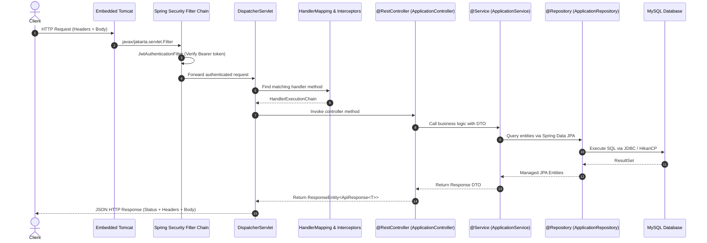

# CareerFlow - Backend Technical & Interview Preparation Guide

This technical guide accompanies the CareerFlow backend codebase. For each module and architectural decision, it explains **what** it does, **why** it is needed, **how** it works internally, the **Spring annotations** used, and typical **SDE / Backend Interview Questions**.

---

## 1. Spring Boot & Architecture Fundamentals

### 1.1 Spring Boot Request-Response Lifecycle
When a client (e.g. browser, Postman) sends an HTTP request to `http://localhost:8080/api/v1/applications`:

### 1.2 Core Architectural Principles

#### Layered Architecture (Controller -> Service -> Repository)
1. **Controller Layer (`@RestController`)**:
   - Sole responsibility: Receive HTTP requests, validate input (`@Valid`), map parameters, delegate to services, and return appropriate HTTP status codes and responses.
   - *Rule:* Never place business logic or direct database queries in controllers.
2. **Service Layer (`@Service`)**:
   - Sole responsibility: Core business rules, validation logic, entity lifecycle management, and transaction boundaries (`@Transactional`).
3. **Repository Layer (`@Repository`)**:
   - Sole responsibility: Data persistence and query execution via Spring Data JPA.
4. **DTO (Data Transfer Object) Pattern**:
   - Entities represent database tables and internal state.
   - Exposing entities directly causes security issues (e.g., exposing password hashes), tight coupling, and circular serialization loops (`Infinite Recursion` with Jackson).
   - DTOs strictly define the API contract.

---

## 2. Common Interview Questions on Layered Architecture

### Q1: Why do we use `@RestController` instead of `@Controller`?
- `@Controller` is the traditional Spring MVC annotation used to render server-side views (like JSP or Thymeleaf). It returns a view name as a String.
- `@RestController` is a convenience annotation that combines `@Controller` and `@ResponseBody`. Every method automatically serializes the returned object directly into JSON/XML written to the HTTP response body using Jackson `HttpMessageConverter`.

### Q2: What is the difference between `@Component`, `@Service`, and `@Repository`?
- `@Component` is the generic stereotype annotation for any Spring-managed bean.
- `@Service` is a specialization of `@Component` indicating business logic. It provides semantic meaning.
- `@Repository` is a specialization of `@Component` for data access. Crucially, Spring applies automatic exception translation to `@Repository` classes—translating native database exceptions (like `SQLException` or Hibernate-specific exceptions) into Spring's unified `DataAccessException` hierarchy.

### Q3: How does Spring Dependency Injection (IoC) work under the hood?
- Spring IoC (Inversion of Control) container creates and manages object instances (Beans) and injects their dependencies at runtime via Reflection.
- **Constructor Injection** (recommended) ensures:
  1. Immutability (`final` fields).
  2. Prevention of `NullPointerException` (cannot construct class without its dependencies).
  3. Ease of unit testing (can pass mock objects directly in test without Spring context).
