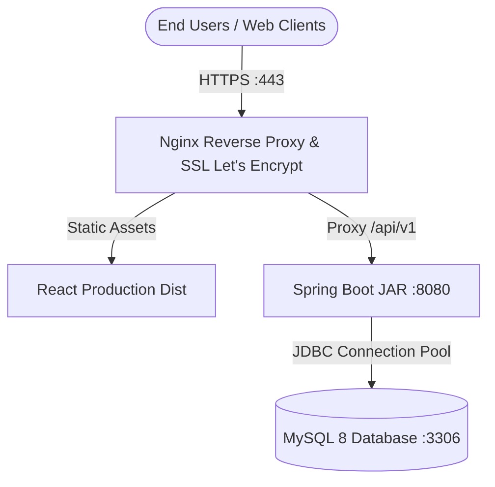

# CareerFlow Production Deployment Guide (Oracle Cloud Always Free & Docker)

This guide covers deploying the CareerFlow Spring Boot 3 backend, MySQL 8 database, and React frontend using **100% free-tier eligible** cloud resources.

---

## 1. Oracle Cloud Always Free Architecture Overview

Oracle Cloud Infrastructure (OCI) offers an industry-leading **Always Free** tier that includes:
- **Compute**: Up to 4 ARM-based Ampere A1 cores and 24 GB of RAM (can be partitioned into 1 or 2 VMs), OR 2 AMD-based Compute VMs (1/8 OCPU, 1 GB RAM each).
- **Storage**: 200 GB total Block Volume storage.
- **Networking**: 10 TB/month outbound data transfer, free public IPv4 address, and free Virtual Cloud Network (VCN).



---

## 2. Containerized Deployment with Docker Compose

Create a `docker-compose.yml` on the Oracle Cloud Ubuntu VM:

```yaml
version: '3.8'

services:
  mysql-db:
    image: mysql:8.0
    container_name: careerflow-mysql
    restart: always
    environment:
      MYSQL_DATABASE: careerflow_db
      MYSQL_ROOT_PASSWORD: ${DB_ROOT_PASSWORD}
      MYSQL_USER: ${DB_USER}
      MYSQL_PASSWORD: ${DB_PASSWORD}
    volumes:
      - mysql_data:/var/lib/mysql
      - ./schema.sql:/docker-entrypoint-initdb.d/init.sql
    ports:
      - "127.0.0.1:3306:3306"
    networks:
      - careerflow-network

  careerflow-backend:
    build:
      context: ./careerflow-backend
      dockerfile: Dockerfile
    container_name: careerflow-backend
    restart: always
    environment:
      SPRING_DATASOURCE_URL: jdbc:mysql://mysql-db:3306/careerflow_db?useSSL=false&allowPublicKeyRetrieval=true&serverTimezone=UTC
      SPRING_DATASOURCE_USERNAME: ${DB_USER}
      SPRING_DATASOURCE_PASSWORD: ${DB_PASSWORD}
      JWT_SECRET: ${JWT_SECRET}
      HIBERNATE_DDL_AUTO: update
    depends_on:
      - mysql-db
    ports:
      - "127.0.0.1:8080:8080"
    networks:
      - careerflow-network

networks:
  careerflow-network:
    driver: bridge

volumes:
  mysql_data:
```

---

## 3. Backend Dockerfile (Multi-stage Build)

Save this as `careerflow-backend/Dockerfile`:

```dockerfile
# Stage 1: Build JAR using Maven
FROM maven:3.9-eclipse-temurin-21 AS build
WORKDIR /app
COPY pom.xml .
RUN mvn dependency:go-offline -B
COPY src ./src
RUN mvn clean package -DskipTests

# Stage 2: Minimal Distroless JRE runtime
FROM eclipse-temurin:21-jre-alpine
WORKDIR /app
COPY --from=build /app/target/careerflow-backend-*.jar app.jar
EXPOSE 8080
ENTRYPOINT ["java", "-jar", "app.jar"]
```

---

## 4. Nginx Reverse Proxy & SSL Configuration

Install Nginx and Certbot on Ubuntu:

```bash
sudo apt update && sudo apt install -y nginx certbot python3-certbot-nginx
```

Configure `/etc/nginx/sites-available/careerflow`:

```nginx
server {
    server_name yourdomain.com www.yourdomain.com;

    # Frontend Static Files
    location / {
        root /var/www/careerflow/dist;
        index index.html;
        try_files $uri $uri/ /index.html;
    }

    # Backend Spring Boot API Proxy
    location /api/ {
        proxy_pass http://127.0.0.1:8080/api/;
        proxy_set_header Host $host;
        proxy_set_header X-Real-IP $remote_addr;
        proxy_set_header X-Forwarded-For $proxy_add_x_forwarded_for;
        proxy_set_header X-Forwarded-Proto $scheme;
    }

    # Swagger Documentation Proxy
    location /swagger-ui/ {
        proxy_pass http://127.0.0.1:8080/swagger-ui/;
        proxy_set_header Host $host;
    }
    location /v3/api-docs {
        proxy_pass http://127.0.0.1:8080/v3/api-docs;
        proxy_set_header Host $host;
    }
}
```

Enable HTTPS via free Let's Encrypt certificates:
```bash
sudo certbot --nginx -d yourdomain.com
```
